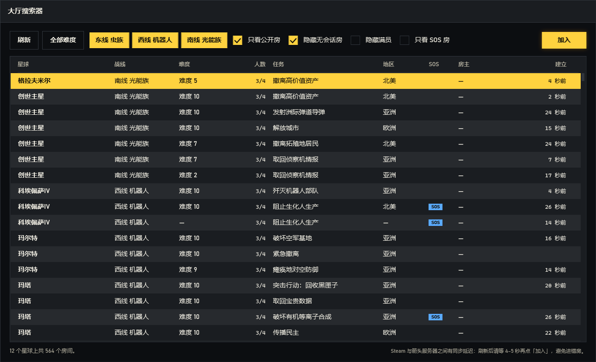

# HD2QD Lobby Browser

A plugin of [HD2 Mod Quick Deploy](https://github.com/pat-pat-patrick/hd2-mod-cli): the public
lobbies of Helldivers 2, listed in a window of the manager, so you pick the one you join instead
of the game's random matchmaking.

Adapted from [HD2LobbyBrowser](https://github.com/QLongYan/HD2LobbyBrowser) (MIT) — the lobby scan,
the lobby keys and the name tables are that program's, ported to a manager plugin.

## What it shows



One row per public lobby: planet, front, difficulty, players, mission, region, SOS, host, age.
Filter by front, difficulty, public only, no-session lobbies, full lobbies, SOS. **Join** (or a
double-click, or Enter) opens `steam://joinlobby/553850/<lobby>/<host>`, so the running game
enters it.

The window is drawn in the manager's own theme and never in WPF's: the ground and card of
`Ground900`/`Ground700`, `Ghost` and `Primary` buttons, `Chip` for the fronts, `Tick` for the
switches, banded rows with the chosen one filled yellow, the thin dark scrollbar. The theme is
taken from the running manager (`Application.Current.TryFindResource`); `Ui.xaml` holds the same
styles with their colours written out, for when it is not the manager drawing — a test window, or
an older manager.

The scan asks Steam for one planet at a time — the planets the game reports as active, from
`api.helldivers2.dev` — because Steam answers at most 50 lobbies per request. When that API cannot
be read, the scan falls back to one worldwide list.

## Install

1. Build it (below) or take `HD2QD.LobbyBrowser.dll` from a release.
2. In HD2 Mod Quick Deploy: **Plugins** page (the jigsaw piece beside the gear) → **Add plugin…**,
   or `hd2qd plugin-add <file>`.
3. Needs manager 0.15.0 or later (plugin Api 2), the Steam client signed in, and Helldivers 2
   installed — the plugin's helper program loads the game's own `steam_api64.dll` to talk to the
   Steam client (never the manager: see below).

## Why the scan runs in another process

Steam treats every process that initialises Steamworks for an App ID as part of that game: it
lists the app as running, and its **Stop** (in the library, or the close inside the game) ends
the processes it knows. HD2LobbyBrowser, which initialised Steamworks itself, was ended with the
game for that reason.

A plugin lives in the manager's process, so the same call would put HD2 Mod Quick Deploy itself
on that list — closing the game would close the manager, its deploy and this window.

So the manager never touches Steamworks. The DLL carries a small program of its own,
`HD2QD.LobbyBrowser.Helper.exe` (64-bit, .NET Framework, embedded in the DLL), writes it to the
manager's settings folder on first use and starts it for each scan. It is the helper that Steam
knows as Helldivers 2, and it lives for one scan: at worst, a Stop ends a scan, and the next
Refresh starts another.

## What it reads, what it writes, what it contacts

- **Reads:** `HKCU\Software\Valve\Steam` (`SteamPath`) and `libraryfolders.vdf` only to find
  `steam_api64.dll` in the game's `bin` folder — or the path in the `HD2_STEAM_API` environment
  variable. Then Steam's public lobby list and lobby data through that DLL. Not the game, not its
  memory, not its files.
- **Writes:** one file, `HD2QD.LobbyBrowser.Helper.<version>.exe`, under the manager's settings
  folder (`%USERPROFILE%\.hd2-mod-cli\lobbybrowser`), written from the DLL's own resource and
  replaced when the plugin updates. No settings, no cache, no log.
- **Contacts:** the Steam client on this PC (local), and `https://api.helldivers2.dev/api/v1/planets`
  for the active planet list (two identifying headers, as that API asks).

## Not ported

The window's ping column, the host platform lookup (PlayFab), the mission multi-select panel,
presets, the global hotkey and the program's own updater: the manager runs the plugin, so the
plugin updates with the manager and the DLL.

## Build

```
build.bat            :: or: dotnet build src\HD2QD.LobbyBrowser.csproj -c Release
```

`release\HD2QD.LobbyBrowser.dll` is the plugin: one file, .NET Framework 4.8, no other file beside
it. `tests\Verify.exe <dll>` checks it against the plugin contract of
[docs/plugin-authors.md](https://github.com/ahe-meow/hd2qd-plugins/blob/main/docs/plugin-authors.md);
`--offline` skips the live scan, `--window` opens the window and writes `window.png`.

---

# HD2QD 大厅搜索器

[HD2 Mod Quick Deploy](https://github.com/pat-pat-patrick/hd2-mod-cli) 的插件：在管理器里列出
《绝地潜兵2》的公开大厅，自己挑房间进，不用随机匹配。

改编自 [HD2LobbyBrowser](https://github.com/QLongYan/HD2LobbyBrowser)（MIT）——大厅扫描、大厅键位
和名称表都来自该项目，移植为管理器插件。

## 能做什么


每个公开大厅一行：星球、战线、难度、人数、任务、地区、SOS、房主、建立时间。可按战线、难度、
只看公开房、隐藏无会话房、隐藏满员、只看 SOS 筛选。点 **加入**（或双击行、回车）打开
`steam://joinlobby/553850/<大厅>/<房主>`，正在运行的游戏随即进入该房间。

窗口用的是管理器自己的主题，不是 WPF 默认控件：`Ground900`/`Ground700` 的底与卡片、`Ghost` 与
`Primary` 按钮、`Chip` 战线、`Tick` 开关、隔行底色与选中行黄底、细窄深色滚动条。主题优先取运行中的
管理器（`Application.Current.TryFindResource`）；`Ui.xaml` 是同一套样式写明颜色的副本，供非管理器
绘制时使用（测试窗口、旧版管理器）。

扫描逐个星球向 Steam 要列表（Steam 每次最多 50 条），星球取自 `api.helldivers2.dev` 报告的
当前活跃星球；读不到该接口时退回一次全球列表。

## 安装

1. 自行构建（见下），或从 release 取 `HD2QD.LobbyBrowser.dll`。
2. 在 HD2 Mod Quick Deploy 的**插件**页（齿轮旁的拼图按钮）点“添加插件…”，或
   `hd2qd plugin-add <文件>`。
3. 需要管理器 0.15.0 以上（插件 Api 2）、Steam 客户端已登录、已安装《绝地潜兵2》——由插件的
   助手程序加载游戏自带的 `steam_api64.dll` 与 Steam 客户端通信（管理器本身不加载，见下）。

## 为什么扫描放在另一个进程里

Steam 会把**任何**为某个 App ID 初始化 Steamworks 的进程当作该游戏的一部分：库里显示“运行中”，
点“停止”（或游戏内关闭）时，它认识的那些进程会被一起结束。HD2LobbyBrowser 自己初始化了
Steamworks，所以关游戏时它也被关掉了。

插件运行在管理器的进程里，同样的调用会把 **HD2 Mod Quick Deploy 自己**写进那份名单——于是关游戏
就连带关掉管理器、正在进行的部署和这个窗口。

所以管理器不碰 Steamworks：DLL 里带着一个自己的小程序 `HD2QD.LobbyBrowser.Helper.exe`
（64 位 .NET Framework，作为资源嵌在 DLL 内），首次使用时写到管理器的设置目录，每次扫描启动一次。
被 Steam 认作《绝地潜兵2》的是这个助手，它只活一次扫描：最坏情况是点“停止”时这次扫描被结束，
再点刷新就重来。

## 读写与联网

- **读**：`HKCU\Software\Valve\Steam`（`SteamPath`）与 `libraryfolders.vdf`，只为找到游戏
  `bin` 目录里的 `steam_api64.dll`（也可用环境变量 `HD2_STEAM_API` 指定）。随后通过该 DLL 读取
  Steam 的公开大厅列表与大厅数据。不读游戏进程、不读内存、不改游戏文件。
- **写**：一个文件 `HD2QD.LobbyBrowser.Helper.<版本>.exe`，写在管理器设置目录
  （`%USERPROFILE%\.hd2-mod-cli\lobbybrowser`）下，来自 DLL 内嵌资源，插件升级时替换。
  不写配置、不写缓存、不写日志。
- **联网**：本机 Steam 客户端（本地），以及 `https://api.helldivers2.dev/api/v1/planets`
  （按其要求带两个标识头）。

## 未移植

延迟列、房主平台查询（PlayFab）、任务多选面板、预设、全局热键、程序自身的更新器：插件由管理器
加载，随管理器与 DLL 更新。

## 构建

```
build.bat            :: 或：dotnet build src\HD2QD.LobbyBrowser.csproj -c Release
```

`release\HD2QD.LobbyBrowser.dll` 即插件：单文件、.NET Framework 4.8，旁边不需要任何其他文件。
`tests\Verify.exe <dll>` 按
[docs/plugin-authors.md](https://github.com/ahe-meow/hd2qd-plugins/blob/main/docs/plugin-authors.md)
检查契约；`--offline` 跳过真实扫描，`--window` 打开窗口并写出 `window.png`。
